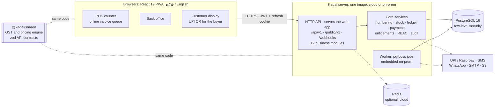

# Kadai (கடை)

> **உங்கள் கடையின் பில்லிங், சரக்கு, கணக்குகள் — தமிழிலேயே**
> Billing, stock and accounts for your shop — in Tamil.

Kadai is a vertical retail ERP for Indian — first of all Tamil Nadu — small and mid-sized shops:
general stores (மளிகை), supermarkets, textile and readymade stores, pharmacies, footwear,
hardware, bakeries and stationery. It covers GST billing at the counter (keyboard-first, barcode
and weighing-scale barcodes, offline-safe PWA), UPI collection (the shop's own UPI ID or Razorpay
dynamic QR with automatic confirmation), stock with batches and expiry, purchases, khata (credit)
with reminders, double-entry accounting and GST returns, with a Tamil-first bilingual UI and
bilingual invoices. **One codebase ships two ways**: a multi-tenant **cloud SaaS** and a
single-tenant **on-premise server** that runs on the shop's own PC or LAN
(`KADAI_MODE=cloud | onprem`). Plans and the on-prem licence are described in
[docs/PRODUCT.md](docs/PRODUCT.md).

**Status.** The foundation is in place and tested end to end: the shared GST/pricing/money engine,
tenancy (PostgreSQL row-level security), authentication (password, OTP, trusted-device PIN),
onboarding with vertical presets, the posting services (gapless numbering, stock, ledger,
payments), the web shell and design system in Tamil and English, and the container, Kubernetes,
on-prem installer and CI kit. The business modules (catalogue, POS and sales, inventory,
purchases, parties, payments/UPI, accounting, reports, notifications, platform/billing) are built
on these contracts; their screens show an "under construction" placeholder until each lands.

## Architecture



- **Correct money**: integer paise, milli-unit quantities and basis-point rates everywhere; the
  same pricing code prices a cart in the browser (offline too) and on the server, which is
  authoritative. Every financial document posts a balanced journal in the same transaction as its
  stock movements and payments.
- **Tenant isolation by construction**: every request runs in one transaction with
  `app.tenant_id` set; RLS policies, composite foreign keys and a separate runtime database role
  keep tenants apart.
- **Cloud vs on-prem** differ only through configuration: entitlements come from the plan and
  subscription in cloud, and from a signed Ed25519 licence file on-prem; UPI is confirmed by
  webhooks in cloud and by status polling on a LAN.

The full contract is [docs/ARCHITECTURE.md](docs/ARCHITECTURE.md); the HTTP surface is
[docs/API.md](docs/API.md).

## Quick start (development)

Prerequisites: **Node.js 22**, **pnpm 10** (`corepack enable`), **PostgreSQL 16**; Redis is
optional.

1. **Database roles** (once, as a PostgreSQL superuser). The runtime role must not own the tables,
   or row-level security would be bypassed:

   ```sql
   CREATE ROLE kadai_owner LOGIN CREATEDB PASSWORD 'kadai_owner';
   CREATE ROLE kadai_app   LOGIN PASSWORD 'kadai_app';
   CREATE DATABASE kadai OWNER kadai_owner;
   \c kadai
   CREATE EXTENSION IF NOT EXISTS pg_trgm;
   CREATE EXTENSION IF NOT EXISTS citext;
   ```

   `.github/scripts/pg-setup.sh kadai kadai_test` does the same (libpq environment, e.g.
   `PGUSER=postgres`). The test database `kadai_test` is created and migrated automatically by
   the server test setup when missing.

2. **Install and configure**

   ```bash
   pnpm install
   cp .env.example .env        # development values: cloud mode, local roles above
   pnpm db:migrate             # apply apps/server/migrations/*.sql
   ```

   `.env.example` carries no secrets: with `JWT_SECRET` / `KADAI_ENCRYPTION_KEYS` empty, development
   uses built-in insecure dev values (a warning is logged) and `NODE_ENV=production` refuses to
   start. Generate real ones as shown at the top of the file.

3. **Run**

   ```bash
   pnpm dev                    # API + worker on :8080, web (Vite) on :5173 proxying /api
   ```

   Open <http://localhost:5173>, choose **இலவசக் கடைக் கணக்கைத் தொடங்குங்கள்** (create a free
   shop account) and sign up; with `SMS_PROVIDER=log` OTP codes are printed in the server log.
   Swagger UI is at <http://localhost:8080/api/docs> outside production.

   To try the **on-prem** flavour, set `KADAI_MODE=onprem` and point `DATABASE_URL` /
   `DATABASE_SYSTEM_URL` at a fresh database: the sign-in page then offers the first-run setup
   wizard (`/setup`), which creates the single business, instead of self-signup.

4. **Production-like run** (one process serving the built web app):

   ```bash
   pnpm build
   node apps/server/dist/server.js       # serves apps/web/dist when KADAI_SERVE_WEB=true
   ```

## Repository layout

```
.
├─ apps/
│  ├─ server/            Fastify API, worker, CLI and SQL migrations
│  │  ├─ migrations/     NNNN_name.sql — forward-only, checksummed
│  │  ├─ scripts/        db-types (kysely-codegen), issue-license, dev licence keys
│  │  └─ src/            config, db, core services, plugins, modules/<name>, jobs, test fixtures
│  └─ web/               React 19 PWA: POS, back office, customer display, platform admin
│     ├─ e2e/            Playwright smoke tests of the production build
│     └─ src/            app shell, components/ui, lib (api, auth, i18n, offline, print), features/<name>, locales/{ta,en}
├─ packages/
│  └─ shared/            isomorphic domain library and zod API contracts (@kadai/shared)
├─ deploy/
│  ├─ docker/            multi-stage Dockerfile, entrypoint, healthcheck
│  ├─ cloud/             docker compose + Caddy for a small cloud install
│  ├─ k8s/               kustomize base, monitoring component, staging/production overlays
│  ├─ onprem/            compose kit, Linux installer, backup/restore/upgrade, systemd, Windows
│  └─ tests/             static validation and end-to-end kit tests
├─ docs/                 architecture, API, product, deployment, runbook
└─ .github/              CI (lint, tests, build, e2e, image, deploy kit) and release workflows
```

Each business module owns one folder per layer (`apps/server/src/modules/<m>`,
`packages/shared/src/api/<m>.ts`, `apps/web/src/features/<m>`) and a migration number band; see
the ownership map in [ARCHITECTURE.md §3.1](docs/ARCHITECTURE.md#31-module-ownership-map).

## Scripts

| Command                                              | What it does                                                                                                         |
| ---------------------------------------------------- | -------------------------------------------------------------------------------------------------------------------- |
| `pnpm dev`                                           | server (`tsx watch`) and web (Vite) together                                                                         |
| `pnpm build`                                         | server bundle (`apps/server/dist`, tsup) and web build (`apps/web/dist`, PWA)                                        |
| `pnpm test`                                          | all tests: shared unit/property tests, server integration tests against PostgreSQL, web component tests              |
| `pnpm typecheck` · `pnpm lint` · `pnpm format:check` | TypeScript (strict), ESLint, Prettier                                                                                |
| `pnpm db:migrate`                                    | apply pending migrations to `DATABASE_SYSTEM_URL`                                                                    |
| `pnpm db:types`                                      | regenerate `apps/server/src/db/schema.generated.ts` from the migrations (`db:types:check` in CI)                     |
| `pnpm --filter @kadai/server db:status`              | list applied / pending migrations                                                                                    |
| `pnpm --filter @kadai/server cli <command>`          | operator CLI: `migrate`, `create-platform-admin`, `issue-license`, `cleanup` (built: `node apps/server/dist/cli.js`) |
| `pnpm --filter @kadai/web e2e`                       | Playwright smoke tests (set `PLAYWRIGHT_BROWSERS_PATH` if browsers are preinstalled)                                 |
| `make help`                                          | deployment shortcuts: image build, kit validation, compose end-to-end tests, bundles                                 |

## Documentation

- [docs/ARCHITECTURE.md](docs/ARCHITECTURE.md) — engineering contract: conventions, database,
  server, posting rules, GST engine, UPI, POS and offline, configuration
- [docs/API.md](docs/API.md) — HTTP API index by module
- [docs/PRODUCT.md](docs/PRODUCT.md) — verticals, plans and pricing, go-to-market
- [docs/DEPLOYMENT.md](docs/DEPLOYMENT.md) — Kubernetes, cloud compose, on-prem Linux and
  Windows, LAN HTTPS, upgrades, backups, provider setup (Razorpay, MSG91, WhatsApp)
- [docs/RUNBOOK.md](docs/RUNBOOK.md) — operational playbooks
- [deploy/onprem/windows/README.md](deploy/onprem/windows/README.md) — Windows shop-PC install
- [apps/server/scripts/dev-keys/README.md](apps/server/scripts/dev-keys/README.md) — licence
  signing keys
